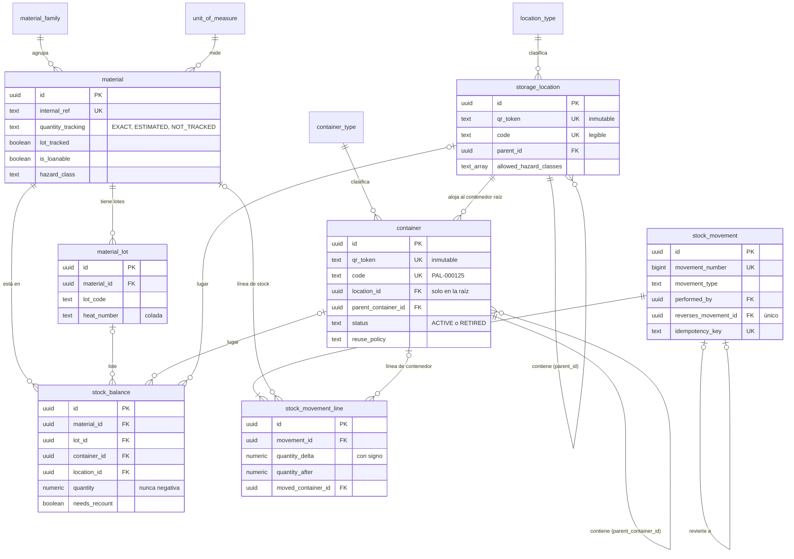
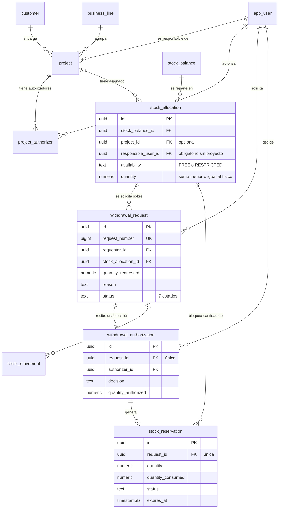
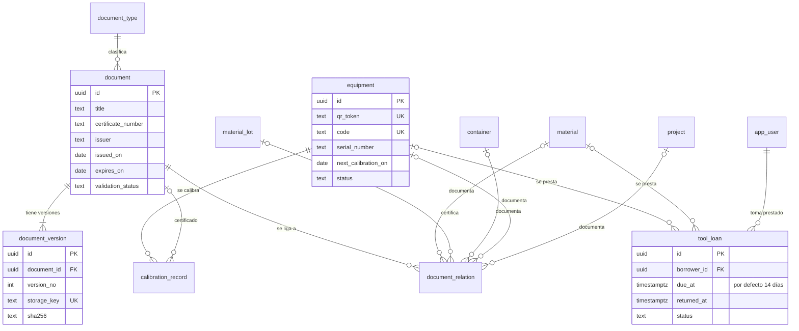
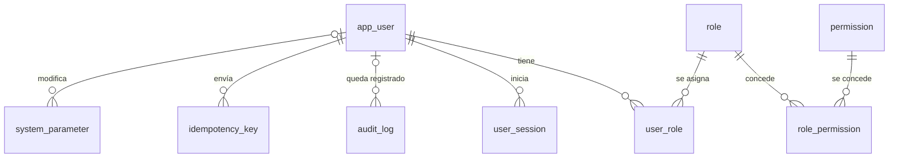

# Modelo de datos del SGA

Estado: **propuesta de la Fase 1, pendiente de validación.**

El modelo tiene 35 tablas y 5 vistas en PostgreSQL 16. Está definido en cuatro
migraciones dentro de `apps/api/migrations`:

| Fichero | Contenido |
| --- | --- |
| `0001_esquema_inicial.sql` | Tablas, claves, índices y restricciones. |
| `0002_reglas_de_integridad.sql` | Triggers y vistas que protegen el inventario. |
| `0003_datos_de_sistema.sql` | Roles, permisos, tipos, unidades y parámetros. |
| `0004_restringido_sin_proyecto.sql` | Material restringido que no pertenece a ningún proyecto. |

## Idea central

- **`stock_balance` es el stock físico:** cuánto hay de un material (y lote) en
  un lugar. El lugar es un contenedor o una ubicación.
- **`stock_allocation` es el reparto lógico:** qué parte de ese saldo está
  reservada o restringida. Lo no asignado es de uso genérico del taller.
- **Solo los movimientos cambian el físico**, y los movimientos nunca se editan
  ni se borran.

## Las cuatro situaciones de un material

| Situación | Cómo se registra | Quién puede retirarlo |
| --- | --- | --- |
| Uso genérico del taller | Sin asignación. Es lo normal al dar entrada. | Cualquier usuario con permiso de retirada. |
| Libre, ligado a un proyecto | Asignación `FREE` con proyecto. | Cualquiera; el proyecto es informativo. |
| Restringido de un proyecto | Asignación `RESTRICTED` con proyecto. | Solo con autorización del responsable o de un autorizador del proyecto. |
| Restringido sin proyecto | Asignación `RESTRICTED` sin proyecto y con responsable designado. | Solo con autorización de ese responsable. |

Un mismo saldo puede repartirse entre varias situaciones: de 100 unidades,
40 restringidas sin proyecto, 50 de un proyecto y 10 de uso genérico.

## Diagramas

### 1. Almacén e inventario

### 2. Proyectos, asignaciones y autorizaciones

### 3. Documentación, equipos y préstamos

### 4. Usuarios, permisos y auditoría

## Tablas

### Usuarios y seguridad

| Tabla | Para qué sirve |
| --- | --- |
| `app_user` | Usuarios de la aplicación. La contraseña se guarda como hash. |
| `role` | Los cinco roles iniciales; se pueden añadir más. |
| `permission` | Acciones concretas que un rol puede hacer (34 al inicio). |
| `role_permission` | Qué permisos tiene cada rol. |
| `user_role` | Qué roles tiene cada usuario. |
| `user_session` | Sesiones iniciadas. Se guarda la huella del token, nunca el token. |
| `system_parameter` | Parámetros ajustables: caducidad de reservas, días de préstamo, etc. |
| `audit_log` | Quién hizo qué y cuándo. Solo admite altas. |
| `idempotency_key` | Evita registrar dos veces una operación reenviada por mala cobertura. |

### Proyectos

| Tabla | Para qué sirve |
| --- | --- |
| `customer` | Clientes. |
| `business_line` | Líneas de negocio. |
| `project` | Proyectos, con su responsable. |
| `project_authorizer` | Quién puede aprobar retiradas restringidas de cada proyecto, además del responsable. |

### Almacén

| Tabla | Para qué sirve |
| --- | --- |
| `location_type` | Tipos de ubicación (zona, pasillo, armario, cajón...). Ampliable. |
| `storage_location` | Ubicaciones fijas, en árbol. |
| `container_type` | Tipos de contenedor (palet, caja, bandeja, genérico). Ampliable. |
| `container` | Contenedores móviles, anidables. Solo el raíz guarda ubicación. |

### Materiales e inventario

| Tabla | Para qué sirve |
| --- | --- |
| `unit_of_measure` | Unidades: ud, m, kg, l... |
| `material_family` | Familias de material. |
| `material` | Catálogo de materiales, con su modo de control de cantidad. |
| `material_lot` | Lotes o coladas de cada material. |
| `stock_balance` | Stock físico: cantidad de un material y lote en un lugar. |
| `stock_allocation` | Reparto de un saldo: por proyecto, o restringido sin proyecto con un responsable. |
| `stock_movement` | Cabecera de cada operación de inventario. Inmutable. |
| `stock_movement_line` | Líneas del movimiento: variaciones de stock o traslados de contenedor. Inmutable. |

### Autorizaciones

| Tabla | Para qué sirve |
| --- | --- |
| `withdrawal_request` | Solicitud de retirada de material restringido. |
| `withdrawal_authorization` | Decisión del autorizador. Una por solicitud. Inmutable. |
| `stock_reservation` | Reserva temporal creada al aprobar. No descuenta stock. |

### Documentación y equipos

| Tabla | Para qué sirve |
| --- | --- |
| `document_type` | Tipos de documento (certificados, planos, albaranes...). |
| `document` | Datos del documento: número, emisor, fechas, validación. |
| `document_version` | Cada fichero subido, con su huella para detectar alteraciones. |
| `document_relation` | A qué se liga el documento: material, lote, contenedor, equipo o proyecto. |
| `equipment` | Equipos de metrología. |
| `calibration_record` | Historial de calibraciones. |
| `tool_loan` | Préstamos de herramientas y equipos, con fecha de devolución. |

### Vistas

| Vista | Qué responde |
| --- | --- |
| `container_effective_location` | Dónde está realmente cada contenedor, siguiendo la cadena hasta el raíz. |
| `container_content` | Qué hay dentro de cada contenedor. |
| `stock_availability` | De cada saldo: físico, restringido, reservado y libre. |
| `container_lot_document` | Qué certificados de lote se ven desde cada contenedor. |
| `equipment_calibration_status` | Si la calibración de cada equipo está vigente, próxima o vencida. |

## Reglas que la base de datos hace cumplir

La API valida lo mismo antes y con mensajes más claros. Estas reglas son la red
de seguridad: aunque la API tuviera un error, la base de datos no aceptaría el
dato.

| N.º | Regla | Cómo se garantiza |
| --- | --- | --- |
| 1 | El stock nunca es negativo. | Restricción CHECK en `stock_balance`. |
| 2 | Dos retiradas simultáneas no pueden sumar más de lo que hay. | Bloqueo de fila; la segunda espera y se rechaza. |
| 3 | El stock está en un contenedor o en una ubicación, no en ambos. | Restricción CHECK. |
| 4 | Un contenedor activo está en una ubicación o dentro de otro. | Restricción CHECK. |
| 5 | No hay ciclos de ubicaciones ni de contenedores. | Trigger. |
| 6 | El token QR no cambia nunca. | Trigger. |
| 7 | Los materiales con control de lote exigen lote. | Trigger. |
| 8 | Un lote solo vale para su material. | Clave foránea compuesta. |
| 9 | Las asignaciones no superan el físico. | Trigger sobre asignaciones y sobre el saldo. |
| 10 | Las reservas activas no superan la asignación. | Trigger. |
| 11 | La solicitud queda ligada a material, lugar y proyecto. | Trigger. |
| 12 | Nadie aprueba su propia solicitud, salvo política del proyecto. | Trigger. |
| 13 | Solo el responsable o un autorizador del proyecto puede decidir. Sin proyecto, solo el responsable designado. | Trigger. |
| 14 | Una decisión por solicitud; parcial significa menos de lo pedido. | Clave única y trigger. |
| 15 | Movimientos, autorizaciones y auditoría no se editan ni se borran. | Trigger. |
| 16 | Un movimiento se revierte una sola vez. | Clave única. |
| 17 | Una operación reenviada no se registra dos veces. | Clave única de idempotencia. |
| 18 | Un documento se liga exactamente a una cosa por relación. | Restricción CHECK. |
| 19 | Un equipo tiene como mucho un préstamo abierto. | Índice único parcial. |
| 20 | El material restringido sin proyecto exige un responsable designado. | Restricción CHECK. |

## Decisiones de diseño que conviene revisar

1. **Sin Prisma.** Las migraciones son SQL directo y la API usará el
   controlador `pg`. Las reglas de arriba (triggers, restricciones parciales)
   se expresan mejor en SQL, y así todo es comprobable sin descargar binarios
   externos.
2. **El administrador técnico no opera inventario.** Gestiona usuarios, datos
   maestros y parámetros, pero no tiene permisos de entrada, retirada ni
   ajuste. Si una persona hace ambas cosas, se le asignan dos roles.
3. **El material sin control de cantidad no se puede reservar ni restringir.**
   Sin cantidad no hay forma de comprobar que el reparto no supera el físico.
   Sigue siendo de uso genérico del taller.
4. **Los armarios, cajoneras y cajones son ubicaciones**, no contenedores. Los
   tipos de contenedor iniciales son palet, caja, bandeja y genérico.
5. **Peligrosidad por etiquetas.** Un material puede marcarse como `LIQUIDO` o
   `QUIMICO`, y cada ubicación declara qué clases admite. La API bloqueará
   guardar un químico fuera de un armario que lo admita.
6. **Las cajas son desechables por defecto** y los palets y bandejas
   reutilizables. Se puede cambiar en cada contenedor.
7. **Préstamos:** un equipo solo puede estar prestado a una persona a la vez.
   Las herramientas gestionadas como material (por cantidad) pueden tener
   varios préstamos abiertos.
8. **Material restringido sin proyecto:** lo autoriza únicamente el
   responsable designado en la asignación, y nunca su propia solicitud. Ser
   responsable de almacén o administrador no basta.

## Cómo se ha comprobado

`apps/api/test/integridad.test.ts` contiene 38 pruebas que se ejecutan contra
un PostgreSQL 16 real. Cada regla de la tabla anterior tiene al menos una
prueba que intenta romperla y verifica que la base de datos lo impide. Todos
los datos de prueba son ficticios y se descartan al terminar.
